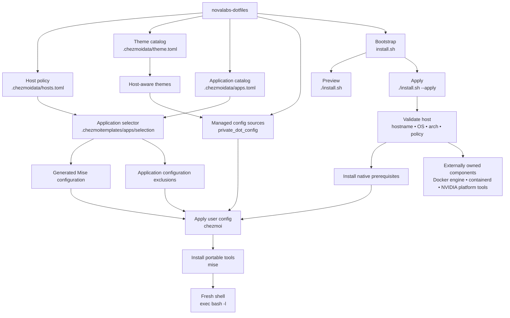

# NovaLabs Dotfiles

ChezMoi + Mise managed configuration for NovaLabs hosts.

- **Authoritative repository:** Forgejo
- **GitHub:** automatically synchronized public push mirror
- **Configuration owner:** ChezMoi
- **Portable CLI owner:** Mise
- **System/package owner:** native OS or platform vendor

The repository is designed around a simple rule: **manage user configuration centrally without taking ownership of platform components that are already managed correctly by the operating system or vendor.**

## 🔄 Update an existing host

> **For previously enrolled Linux hosts.** Use this workflow to synchronize
> the latest NovaLabs configuration and Mise-managed tools.

### 1. Synchronize and preview

```bash
cd ~/novalabs-dotfiles
git pull --ff-only

# Preview bootstrap and native package changes
./install.sh

# Inspect pending ChezMoi changes
chezmoi diff

# Verify without applying configuration changes
chezmoi apply --dry-run --verbose
```

Review the output before proceeding.

### 2. Apply and reload

If the preview is correct:

```bash
./install.sh --apply
exec bash -l
```

This reconciles the host configuration, installs pinned Mise tools,
and reports unused Mise installations without deleting them.

### Important notes

- **Fleet rollout:** Update one representative host before deploying
  changes across the fleet.
- **Garbage collection:** Use `./install.sh --apply --prune` only when
  explicitly performing Mise cleanup. See
  [Mise garbage collection](#mise-garbage-collection).
- **ChezMoi scripts:** `chezmoi diff` may display eligible run scripts
  even when managed files have converged. Review these separately.
- **ChezMoi pager:** External pagers are disabled in `.chezmoi.toml.tmpl` to avoid conflicts with interactive overwrite prompts. ChezMoi retains its normal modified-file protection.
- **Locally modified files:** Review unexpected differences before applying. Do not use a global `--force` to bypass conflicts.

---

**New host?** See [Bootstrap a new Linux host](#bootstrap-a-new-linux-host)
for first-time enrollment.

## Architecture

NovaLabs Dotfiles separates responsibilities into four ownership categories.

| Layer | Owner | Examples |
|---|---|---|
| User configuration | ChezMoi | Bash, Git include, Starship, Fastfetch, btop theme, LazyVim, tmux, Vim, LazyGit, LazyDocker |
| Application declarations | Application catalog | Exact version pins, Mise backend identifiers, profile eligibility |
| Portable userland tools | Mise | Neovim, Node, Rust, Tree-sitter CLI, ripgrep, fd, fzf, Starship, LazyGit, LazyDocker, K9s, Dive, LazyJournal, Network Doctor, infrastructure TUIs |
| System/platform components | OS or vendor | OpenSSH, Docker engine, containerd, NVIDIA platform packages |

Declarative policy is separated into three catalogs:

- `.chezmoidata/hosts.toml` — host identity and platform policy.
- `.chezmoidata/apps.toml` — application versions and deployment scope.
- `.chezmoidata/theme.toml` — host palettes and shared semantic colors.

See the [Application Catalog documentation](docs/application-catalog.md)
for the application schema, selection rules, and validation workflow.

### Infrastructure TUI applications

NovaLabs provides a curated set of terminal-based infrastructure
administration, observability, and diagnostic applications.

| Application | Executable | Deployment scope |
|---|---|---|
| K9s | `k9s` | Any, Lovelace, Worker1 |
| Dive | `dive` | Any, Docker, ZGX |
| LazyJournal | `lazyjournal` | All managed Linux profiles |
| Network Doctor | `netdoc` | All managed Linux profiles |
| tui-cert | `tui-cert` | All managed Linux profiles |
| tui-disk | `tui-disk` | All managed Linux profiles |
| tui-systemd | `tui-systemd` | All managed Linux profiles |
| tui-traffic | `tui-traffic` | All managed Linux profiles |
| tui-cron | `tui-cron` | All managed Linux profiles |
| tui-ssh | `tui-ssh` | All managed Linux profiles |

All ten applications have passed native AMD64 and ARM64 installation
and executable smoke tests using the pinned Mise runtime.

Application installation does not grant additional system privileges
or transfer ownership of underlying infrastructure components.

See the [Infrastructure TUI documentation](docs/application-catalog.md#infrastructure-tui-applications)
for runtime requirements, validation results, release integrity
considerations, and ownership migration requirements.

### Infrastructure TUI themes

Infrastructure TUI appearance is derived from the centralized
`.chezmoidata/theme.toml` catalog and the selected host profile.

| Applications | Appearance | Configuration ownership |
|---|---|---|
| Six tui-kit applications | Shared host-specific RGB palette | Managed |
| K9s | Host-specific RGB skin with status-aware selection | Managed skin only |
| LazyJournal | Host-specific named terminal colors | Create-only |
| Network Doctor | Native `contrast` preset | Create-only |
| Dive | Native appearance | Unmanaged |

The shared Bash environment automatically activates the managed
tui-kit palette and K9s skin when their configuration files exist.
Explicit non-empty environment overrides are preserved.

LazyJournal and Network Doctor preferences are initialized only when
absent, preserving existing configurations and subsequent user changes.

All nine customized applications have passed native theme-loading and
visual validation on AMD64. Installation and executable smoke tests
have separately passed on AMD64 and ARM64.

See [Infrastructure TUI themes](docs/application-catalog.md#infrastructure-tui-themes)
for configuration paths, palette mappings, ownership boundaries,
activation behavior, and runtime validation details.

## System map



### Ownership vocabulary

| Value | Meaning |
|---|---|
| `managed` | NovaLabs owns and converges the component. |
| `external` | The host or platform owns it. NovaLabs may require and validate it, but does not install, upgrade, remove, or reconfigure it. |
| `skip` | The component is outside this profile. |
| `optional` | The component is enabled only when the host enrollment selects it. |
| `optional-external` | Optional component that must already exist when enabled. |
| `stage-only` | The profile exists for representation and validation, but the generic bootstrap must not mutate the host. |

## Host profiles

| Profile | Host identity | Platform | Runtime policy | Status |
|---|---|---|---|---|
| `any` | Any hostname | Linux AMD64/ARM64 | Shared userland tools; no native package management | Ready for testing |
| `proxmox` | `nova` | Debian AMD64 | no Docker | migrated |
| `docker` | `docker` | Debian/Ubuntu AMD64 | Docker external; LazyDocker managed | migrated |
| `pihole` | `pihole`, `pihole2` | Debian/Raspbian AMD64 | no Docker | migrated |
| `ubuntulab` | `ubuntulab`, `ubuntu-proxmox` | Ubuntu AMD64 | optional external Docker | migrated |
| `lovelace` | `lovelace` | Debian ARM64 | containerd | migrated |
| `worker1` | `k8s-worker-01` | Debian AMD64 | containerd | migrated |
| `zgx` | `zgx`, `zgx-40e6` | Ubuntu ARM64 | NVIDIA-managed Docker; GPU btop preserved | migrated |
| `opnsense` | `opnsense`, `opnsense2` | FreeBSD AMD64 | stage-only | pending FreeBSD validation |

### Generic Linux profile (`any`)

The `any` profile provides the NovaLabs terminal environment on
Linux hosts that do not have a dedicated host profile.

Select `any` during first-time ChezMoi enrollment. No hostname
registration or host-specific configuration is required.

**Included:**

- Dracula Classic theme for Starship, Fastfetch, and btop
- Shared Bash configuration, aliases, and helper functions
- Neovim/LazyVim configuration
- Common pinned mise applications, including Starship,
  Fastfetch, btop, Git utilities, Node.js, and Rust
- Shared user-level configuration managed by ChezMoi

**Platform requirements:**

- Linux AMD64 or ARM64
- Bash, Git, and curl or wget
- `/etc/os-release`
- A compatible mise runtime and system libraries
- Required compilation tools for source-built applications
- Network access for initial tool installation

The generic bootstrap installs only the native prerequisites required by the shared mise toolchain. On Debian-family distributions, these are currently `build-essential` and `libatomic1`, installed through APT before ChezMoi configuration is applied.

On other Linux distributions, native dependencies remain externally managed. Install a compatible C build toolchain and the `libatomic.so.1` runtime library using the distribution's package manager.

The generic profile does not install the full NovaLabs infrastructure package baseline or manage system services. Automatic dependency provisioning is currently validated only on Ubuntu 24.04 AMD64.

LazyDocker, Dive, K9s, and the shared infrastructure TUI applications
are included in the `any` profile through the application catalog.

Docker engine availability, Kubernetes connectivity, systemd access,
and other application runtime requirements remain separate from
application installation.

The generic profile does not automatically grant additional privileges
or install infrastructure services to satisfy these runtime requirements.

Chronytop and SSH server configuration are not managed by the
`any` profile.

The profile is designed for portable Linux user environments.
Compatibility across distributions has not yet been fully verified.

After enrollment, the generic profile remains selected until
ChezMoi's enrollment configuration is explicitly changed.

## Repository layout

```text
.
├── .chezmoi.toml.tmpl
├── .chezmoidata/
│   ├── apps.toml
│   ├── hosts.toml
│   └── theme.toml
├── .chezmoiignore.tmpl
├── .chezmoiscripts/
├── .chezmoitemplates/
│   ├── apps/
│   │   └── selection
│   ├── fastfetch/
│   └── starship/
├── docs/
│   ├── application-catalog.md
│   └── migration-ledger.md
├── scripts/
│   ├── test-app-catalog.py
│   ├── test-theme-catalog.py
│   └── test-theme-env.sh
├── private_dot_config/
│   ├── btop/
│   ├── mise/
│   ├── nvim/
│   ├── fastfetch/
│   ├── lazygit/
│   ├── lazydocker/
│   ├── k9s/
│   │   └── skins/
│   ├── lazyjournal/
│   ├── netdoc/
│   ├── novalab/
│   │   ├── bash/
│   │   └── themes/
│   └── ...
├── modify_dot_bashrc
├── modify_dot_gitconfig
├── dot_tmux.conf
├── dot_vimrc
└── install.sh
```

Important source paths:

- `.chezmoidata/hosts.toml` — host identity, platform, mutation and runtime policy
- `.chezmoidata/theme.toml` — host palette data
- `private_dot_config/mise/config.toml.tmpl` — generic Mise configuration renderer
- `.chezmoiignore.tmpl` — profile-dependent configuration inclusion
- `.chezmoitemplates/starship/` — per-profile Starship templates
- `.chezmoitemplates/fastfetch/` — per-profile Fastfetch templates
- `private_dot_config/btop/themes/novalab.theme.tmpl` — host-colored btop theme
- `private_dot_config/nvim/` — LazyVim configuration and plugin lockfile
- `install.sh` — preview-first bootstrap and native package convergence
- `.chezmoidata/apps.toml` — portable application declarations and exact version pins
- `.chezmoitemplates/apps/selection` — shared application eligibility selector
- `scripts/test-app-catalog.py` — automated application catalog validation
- `private_dot_config/novalab/themes/` — shared infrastructure TUI palettes
- `private_dot_config/private_k9s/private_skins/` — host-specific K9s skins and private directory permissions
- `private_dot_config/lazyjournal/` — initial LazyJournal interface configuration
- `private_dot_config/netdoc/` — initial Network Doctor theme preference
- `scripts/test-theme-catalog.py` — automated theme catalog validation
- `scripts/test-theme-env.sh` — shell theme activation regression tests
- `scripts/test-theme-permissions.sh` — isolated Linux filesystem permission and application subtree eligibility validation

## Bootstrap a new Linux host

Clone the repository. Hosts without Forgejo SSH access may use the public GitHub mirror.

```bash
git clone https://github.com/calico88x/novalabs-dotfiles.git ~/novalabs-dotfiles
cd ~/novalabs-dotfiles
```

Preview the bootstrap first:

```bash
./install.sh
```

The preview shows the platform, pinned bootstrap versions and native package set. It makes no changes.

Apply only after the preview is understood:

```bash
./install.sh --apply
```

During first enrollment, ChezMoi prompts for the host profile. UbuntuLab also asks whether optional Docker tooling is enabled.

After a successful initial apply:

```bash
exec bash -l
```

The active profile is available as:

```bash
echo "$NOVALAB_HOST_PROFILE"
```

For an unregistered Linux machine, choose `any`. This applies the
shared NovaLabs configuration without requiring a dedicated host
definition. Unlike named Debian-family profiles, `any` skips APT
package convergence and leaves native dependency management to the
host operating system.

### High-scrutiny enrollment

For a new, unusual, or production-sensitive host, initialize ChezMoi manually and inspect the rendered state before allowing the bootstrap to mutate the system. This is the workflow used to migrate the existing NovaLabs fleet.

Install the pinned Mise bootstrap:

```bash
curl -fsSL https://mise.run |
  MISE_VERSION=v2026.8.9 \
  MISE_INSTALL_PATH="$HOME/.local/bin/mise" \
  sh
```

Initialize ChezMoi from the cloned repository:

```bash
~/.local/bin/mise x aqua:twpayne/chezmoi@2.72.1 -- \
  chezmoi -S "$HOME/novalabs-dotfiles" init
```

ChezMoi prompts for the host profile during first initialization. UbuntuLab also prompts for optional Docker tooling.

Confirm the saved enrollment data:

```bash
cat ~/.config/chezmoi/chezmoi.toml
```

Inspect the rendered desired state:

```bash
~/.local/bin/mise x aqua:twpayne/chezmoi@2.72.1 -- \
  chezmoi diff
```

Run the host validator explicitly:

```bash
~/.local/bin/mise x aqua:twpayne/chezmoi@2.72.1 -- \
  chezmoi -S "$HOME/novalabs-dotfiles" execute-template \
  < "$HOME/novalabs-dotfiles/.chezmoiscripts/run_before_10-validate-host.sh.tmpl" |
  sh
```

Dry-run the apply:

```bash
~/.local/bin/mise x aqua:twpayne/chezmoi@2.72.1 -- \
  chezmoi apply --dry-run --verbose
```

For profiles that depend on an externally owned Docker runtime, verify it before applying:

```bash
docker info >/dev/null &&
  echo "Docker runtime: PASS"
```

Once the rendered state, validator and dry-run are correct:

```bash
./install.sh --apply
exec bash -l
```

The bootstrap runs host validation before any `sudo`, native package installation, or ChezMoi apply.

## Add a portable tool

Before adding anything, decide who should own it.

```text
OS/service dependency?
    -> native OS package layer

Existing vendor/platform component?
    -> external; validate but do not take ownership

Portable userland CLI?
    -> Application catalog + Mise

User configuration for that CLI?
    -> ChezMoi
```

### 1. Declare the application

Edit `.chezmoidata/apps.toml`.

Example:

```toml
[apps.example]
backend = "aqua:vendor/example"
version = "1.2.3"
profiles = ["all-linux"]
```

All application versions must use exact pins.

For profile-specific applications, declare the eligible profiles:

```toml
[apps.example]
backend = "aqua:vendor/example"
version = "1.2.3"
profiles = ["any", "docker"]
```

The application selector automatically excludes unsupported platforms and unmanaged hosts.

See the [Application Catalog documentation](docs/application-catalog.md) for advanced installation options, exclusions, and optional enrollment conditions.

### 2. Add configuration when required

Place application configuration under `private_dot_config/` using ChezMoi naming conventions.

For example:

```text
private_dot_config/example/config.toml
    -> ~/.config/example/config.toml
```

If configuration should only be deployed on eligible hosts, use the
shared application selector in `.chezmoiignore.tmpl`.

Exclude both the application-specific directory and its descendants
when the application is ineligible. Excluding individual files alone
can leave parent directories under ChezMoi management.

For example, an ineligible application's configuration subtree should
produce the following ignore patterns:

```text
.config/example/
.config/example/**
```

Use the narrowest application-owned subtree. Do not exclude shared
configuration directories that contain unrelated managed files.

Existing excluded configuration directories and files remain unmanaged.
Exclusion does not remove previously deployed files or uninstall
applications.

Do not duplicate application deployment conditions.

### 3. Validate the catalog

Run the automated validation script from the repository root:

```bash
python scripts/test-app-catalog.py
```

Review the resulting Git diff:

```bash
git diff --check
git diff
```

The validation script renders every declared host profile without
installing applications or applying configuration.

Independent application eligibility assertions also protect the
intended enrollment policies for K9s, Dive, LazyDocker, and the
shared infrastructure TUI applications.

### 4. Validate on a representative host

Use the standard preview workflow:

```bash
chezmoi cat ~/.config/mise/config.toml
chezmoi diff
chezmoi apply --dry-run --verbose
```

After reviewing the desired changes:

```bash
./install.sh --apply
```

Confirm the installed executable and version:

```bash
command -v example
example --version
```

Validate both AMD64 and ARM64 compatibility when applicable before fleet deployment.

Do not edit the generated Mise configuration directly.

## Modify configuration

Edit the **repository source**, not the deployed file on each host.

Common mappings:

| Repository source | Target |
|---|---|
| `private_dot_config/bat/config` | `~/.config/bat/config` |
| `private_dot_config/lazygit/config.yml` | `~/.config/lazygit/config.yml` |
| `private_dot_config/lazydocker/config.yml` | `~/.config/lazydocker/config.yml` |
| `private_dot_config/nvim/` | `~/.config/nvim/` |
| `dot_tmux.conf` | `~/.tmux.conf` |
| `dot_vimrc` | `~/.vimrc` |
| `private_dot_config/novalab/themes/tui-kit.toml.tmpl` | `~/.config/novalab/themes/tui-kit.toml` |
| `private_dot_config/private_k9s/private_skins/novalab.yaml.tmpl` | `~/.config/k9s/skins/novalab.yaml` |
| `private_dot_config/lazyjournal/create_config.yml.tmpl` | `~/.config/lazyjournal/config.yml` (create-only) |
| `private_dot_config/netdoc/create_theme.tmpl` | `~/.config/netdoc/theme` (create-only) |

### Bash and Git are modifier-managed

NovaLabs intentionally does **not** own the entire `~/.bashrc` or `~/.gitconfig`.

- `modify_dot_bashrc` replaces only the NovaLabs managed block.
- `modify_dot_gitconfig` replaces only the shared NovaLabs Git include.
- Personal shell content and Git identity remain host-local.

Do not replace these with whole-file dotfiles unless that ownership decision is made deliberately.

### btop configuration is intentionally writable

`private_dot_config/btop/create_btop.conf` seeds `~/.config/btop/btop.conf` rather than continuously replacing a user's runtime settings.

The NovaLabs btop theme is managed separately.

On ZGX, the existing GPU-enabled `/usr/local/bin/btop` is explicitly preserved and is **not** installed through Mise.

### Neovim and LazyVim

Neovim itself is installed and version-pinned by Mise.

Tree-sitter support uses a Mise-managed Rust toolchain and a source-built Tree-sitter CLI:

```text
Rust:             1.99.1
Tree-sitter CLI:  0.26.9
```

Tree-sitter CLI is built through Cargo with default features disabled. This avoids relying on upstream Linux binaries whose glibc requirements may be newer than some NovaLabs hosts.

The Debian-family native baseline includes `build-essential` so Tree-sitter CLI and parser modules have a C compiler and linker available.

LazyVim is configuration, so ChezMoi owns:

```text
~/.config/nvim/
```

from:

```text
private_dot_config/nvim/
```

The managed LazyVim tree includes:

- `init.lua`
- `lazyvim.json`
- `lazy-lock.json`
- `stylua.toml`
- `lua/config/`
- `lua/plugins/`

The committed `lazy-lock.json` preserves plugin revisions across hosts.

#### LazyVim plugin lockfile policy

`lazy-lock.json` is version-controlled and managed by ChezMoi.

The repository is the authoritative source for plugin revisions across NovaLabs hosts.

**Updating plugins**

1. Select an authoring machine for the update.
2. Run `:Lazy update` in Neovim.
3. Validate Neovim startup and plugin functionality.
4. Copy the updated `~/.config/nvim/lazy-lock.json` into `private_dot_config/nvim/lazy-lock.json` in the repository.
5. Review the Git diff, commit the lockfile change, and push it.
6. Deploy the updated repository to other hosts using the normal ChezMoi workflow.
7. Run `:Lazy restore` in Neovim on each host to synchronize installed plugins with the committed lockfile.

**Handling local differences**

Neovim may modify its local lockfile when plugins are updated.

When ChezMoi detects a modified `lazy-lock.json`:

- Review the difference before overwriting.
- If the update was intentional, validate and promote it into the repository.
- Otherwise, restore the repository-managed lockfile through ChezMoi and run `:Lazy restore`.
- Never automatically overwrite all ChezMoi-managed files to resolve a lockfile conflict.

Plugin updates should be deliberate, reviewed changes rather than independent upgrades across hosts.

On first launch, Neovim bootstraps `lazy.nvim` and installs the LazyVim/plugin set defined by the managed configuration.

Starter-only files such as the LazyVim starter `README.md`, `LICENSE`, `.gitignore`, `.neoconf.json`, and inactive `example.lua` are intentionally not managed.

### Host visual configuration

The centralized theme catalog defines host identity, shared semantic
colors, interface surfaces, and application-specific appearance preferences.

| Component | Configuration strategy |
|---|---|
| Starship | Explicit per-profile templates |
| Fastfetch | Explicit per-profile templates |
| btop | Generated host-specific theme |
| tui-kit applications | Generated shared RGB palette |
| K9s | Generated native host-specific skin |
| LazyJournal | Create-only named color configuration |
| Network Doctor | Create-only native theme preference |
| Dive | Native appearance |

Host palette data is maintained in `.chezmoidata/theme.toml`.

Starship and Fastfetch currently retain explicit per-profile templates
to preserve migration parity.

Managed themes are converged through ChezMoi. Create-only
configurations preserve existing user preferences and are not
automatically overwritten when catalog defaults change.

Theme deployment follows application eligibility through the shared
application selector.

Application-specific configuration subtrees are excluded from ChezMoi
management when their corresponding applications are ineligible.

The shared tui-kit themes directory is managed when at least one
compatible application is eligible.

Excluded subtrees are not created or reconciled. Existing unmanaged
files, directory permissions, and user preferences are preserved.

See [Infrastructure TUI themes](docs/application-catalog.md#infrastructure-tui-themes)
for implementation details and configuration ownership rules.

#### K9s configuration ownership

NovaLabs manages the host-specific K9s skin and restrictive directory
permissions through ChezMoi.

| Destination | Permissions |
|---|---|
| `~/.config/k9s/` | `0700` |
| `~/.config/k9s/skins/` | `0700` |
| `~/.config/k9s/skins/novalab.yaml` | `0644` |

General K9s configuration, aliases, Kubernetes credentials, plugins,
and runtime state remain user-owned.

Existing K9s installations must be retained until the Mise-managed
replacement and shell PATH precedence have been verified.

Package-managed installations must be retired through their package
manager. Standalone installations require a recoverable rollback path.

See the application catalog for host-specific ownership exceptions
and filesystem permission validation.

#### Theme regression testing

Theme changes must be validated from the repository root:

```bash
python scripts/test-theme-catalog.py
bash scripts/test-theme-env.sh
bash scripts/test-theme-permissions.sh
```

The theme catalog test requires Python 3.11 or newer, ChezMoi, and
PyYAML in the development environment.

The shell regression suites require Bash and can be executed on Linux
or through WSL.

The filesystem permission test additionally requires ChezMoi on PATH
and standard Linux filesystem utilities.

The filesystem regression suite uses the repository's actual application
selector, ignore rules, theme data, and configuration templates.

It validates six scenarios against isolated temporary destinations:

1. Fresh K9s installation with restrictive directory permissions.
2. Existing K9s installation with user configuration preservation.
3. Permission drift correction and repeated reconciliation.
4. Fresh ZGX enrollment without an ineligible K9s configuration subtree.
5. Preservation of existing unmanaged K9s files and directory permissions
   on a K9s-ineligible host.
6. Infrastructure TUI configuration subtree exclusion for the OPNsense
   profile.

The OPNsense scenario validates configuration eligibility on a Linux
test runner. It does not constitute native FreeBSD deployment testing.

No live host configuration or Kubernetes credentials are modified
by these regression tests.

Native application behavior must also be checked when introducing new
theme properties or upgrading applications.

### Validate a config change

On the authoring workstation:

```powershell
git diff --check
git diff
```

On a representative target host:

```bash
cd ~/novalabs-dotfiles
git pull --ff-only
chezmoi diff
chezmoi apply --dry-run --verbose
```

Then:

```bash
./install.sh --apply
```

After changing shell, prompt, PATH or tool configuration, start a fresh login shell:

```bash
exec bash -l
```

## Add or modify a host profile

A host profile is represented in several places. Treat these changes as a single unit.

### 1. Declare host policy

Edit:

```text
.chezmoidata/hosts.toml
```

Example:

```toml
[hosts.example]
display_name = "Example"
hostnames = ["example"]
markers = []
kernel = "linux"
os_family = "debian"
expected_ids = ["ubuntu"]
expected_architectures = ["amd64"]
mutation = "managed"
container_runtime = "none"
docker = "skip"
lazydocker = "skip"
ssh = "systemd-managed"
```

Use host markers when hostname matching alone is not sufficient.

### 2. Add the profile to ChezMoi enrollment

Update the profile list in:

```text
.chezmoi.toml.tmpl
```

Add extra enrollment prompts only when a host genuinely has optional behavior.

### 3. Add visual identity

If the host has a distinct theme:

- add or update palette data in `.chezmoidata/theme.toml`
- define the supported LazyJournal accent for managed Linux profiles
- add a Starship profile template
- add a Fastfetch profile template
- verify the btop theme renders correctly
- verify eligible infrastructure TUI configurations render correctly
- run `python scripts/test-theme-catalog.py`
- run `bash scripts/test-theme-env.sh` from Linux or WSL

### 4. Add tool/config exceptions

If a host needs a different application policy:

- Update the relevant application declarations in `.chezmoidata/apps.toml`.
- Update `.chezmoiignore.tmpl` where configuration exclusions are required.
- Use the shared application selector instead of duplicating profile conditions.
- Record platform ownership and preservation requirements in `.chezmoidata/hosts.toml`.
- Run `python scripts/test-app-catalog.py`.

### 5. Add bootstrap validation when needed

`install.sh` should validate externally owned runtime prerequisites but should not silently take ownership of them.

Examples already implemented:

- Docker LXC: existing OS-owned Docker required
- UbuntuLab with Docker enabled: existing Docker CE required
- ZGX: existing NVIDIA-managed Docker required

### 6. Validate identity before mutation

The generated validator checks:

- hostname or required marker
- kernel
- OS ID
- architecture
- mutation policy

A profile mismatch must fail before native package installation or ChezMoi apply.

For a new profile, use the high-scrutiny enrollment workflow before enabling normal bootstrap application.

## Update tool versions

Tool upgrades are deliberate repository changes.

1. Verify the upstream release and supported architectures.
2. Change the exact version pin in `.chezmoidata/apps.toml`.
3. Review native configuration and theme compatibility.
4. Run `python scripts/test-app-catalog.py`.
5. Run the applicable theme and shell environment regression suites.
6. Review the Git diff.
7. Test rendering and installation on a representative host.
8. Verify the tool launches and its configuration remains compatible.
9. Commit, push, and roll out normally.

Bootstrap infrastructure is pinned separately in `install.sh`:

```text
Mise:     2026.8.9
ChezMoi:  2.72.1
```

Do not update those pins merely because Mise reports that a newer version exists.

If the bootstrap pins are intentionally changed, validate the new Mise and ChezMoi versions independently before rolling them into the fleet.

## Native package baseline

The current Debian-family bootstrap baseline is:

```text
build-essential
ca-certificates
curl
git
gzip
libatomic1
htop
openssh-server
procps
sudo
tar
tmux
vim
```

Native packages are converged with `apt-get`.

This layer is for OS-level prerequisites and tools that should remain distribution-managed. Portable CLI tools should normally use Mise instead.

## Proxmox — Chronytop

[Chronytop](https://github.com/geerlingguy/chronytop) is a terminal-based Chrony monitoring application, installed exclusively on the Proxmox time server.

- **Host policy:** `chronytop = "managed"`
- **Version policy:** Latest published GitHub release
- **Installation:** `/usr/local/bin/chronytop`
- **Ownership:** `root:root`, permissions `0755`
- **Verification:** SHA-256 checksum from the same upstream release
- **Prerequisite:** Existing, system-managed Chrony installation

Run with:

```bash
sudo chronytop
```

During normal reconciliation, `install.sh` checks the latest upstream release and installs Chronytop only when the existing binary or its ownership and permissions do not match the desired state.

Chrony's daemon, service, and time synchronization configuration remain externally managed.

Unlike the pinned Mise toolchain, Chronytop intentionally tracks upstream releases. Review upstream changes before reconciling Proxmox when strict version stability is required.

On Proxmox, ./install.sh --apply may automatically install a newer Chronytop release. The bootstrap preview does not currently report available Chronytop updates.

## Docker policy

NovaLabs does not own the Docker engine on the current Docker-capable hosts.

### Docker LXC

Docker is externally managed by the host OS. NovaLabs verifies that it exists and is usable. LazyDocker is managed by Mise/ChezMoi.

### UbuntuLab

Docker support is optional. When enabled, the existing Docker installation remains external. LazyDocker becomes managed.

### ZGX

Docker and NVIDIA container integration are platform-managed by the NVIDIA repositories and DGX software stack. NovaLabs validates the runtime but does not install or alter it.

## ZGX btop exception

ZGX uses a custom GPU-aware btop build:

```text
/usr/local/bin/btop
```

The profile records:

```toml
preserve_present_tools = ["btop"]
```

The generic Mise btop package must not be added to the ZGX rendered tool list.

The existing `btop.conf` is preserved as a writable file; only the managed theme is converged.

When changing btop-related logic, verify the ZGX binary before and after the change:

```bash
command -v btop
btop --version
```

The expected binary is `/usr/local/bin/btop`, compiled with GPU support.

## OPNsense

OPNsense is currently:

```toml
mutation = "stage-only"
```

The generic bootstrap detects FreeBSD and exits without modifying the system.

Do not change OPNsense to `managed` until the FreeBSD package, filesystem, shell and service behavior has been deliberately tested.

## Git workflow

Forgejo is authoritative. GitHub is an automatically synchronized
public push mirror.

Repository changes should be developed on feature branches, reviewed,
validated, and committed before integration into `main`.

The repository enforces LF line endings for shared ChezMoi templates
under `.chezmoitemplates/`, including extensionless templates such as
the application eligibility selector.

When using Windows and WSL against the same working tree, inspect
unexpected line-ending differences before staging changes. Avoid
repository-wide normalization or global Git configuration changes as
a workaround for individual file discrepancies.

On the authoring workstation, inspect the configured remotes:

```powershell
git remote -v
```

The authoring repository uses the following remotes:

| Remote | Responsibility |
|---|---|
| `forgejo` | Authoritative repository operations and feature branch publication |
| `github` | Public mirror inspection and synchronization verification |

Normal development pushes are directed to Forgejo.

Forgejo automatically mirrors repository changes, including feature
branches and main branch updates, to GitHub.

Before committing, run the applicable regression tests and review
the changes:

```powershell
git diff --check
git diff
```

For bootstrap shell-script changes:

```powershell
wsl bash -n /mnt/c/Users/Nova/workspaces/novalabs-dotfiles/install.sh
```

For theme environment and filesystem permission changes:

```bash
bash scripts/test-theme-env.sh
bash scripts/test-theme-permissions.sh
```

Stage the intended files explicitly and review the staged changes
before creating a commit.

```powershell
git diff --cached --check
git diff --cached
```

Push the feature branch to Forgejo and review it through a pull request
before integrating it into `main`.

### Public mirror verification

After integrating reviewed changes into the authoritative `main`
branch, verify that GitHub has received the same commit.

```powershell
git rev-parse main
git ls-remote --heads forgejo refs/heads/main
git ls-remote --heads github refs/heads/main
```

All three commit identifiers should match before deploying that
release through the GitHub mirror.

Refresh local GitHub remote-tracking references when necessary:

```powershell
git fetch --prune github
git log --oneline github/main..main
```

A stale local remote-tracking reference does not necessarily indicate
that the remote repository is behind.

Use `git ls-remote` to inspect the actual remote branch state.

Manual pushes to GitHub are not required during normal repository
development or deployment. Investigate automatic mirror failures
rather than bypassing the authoritative repository workflow.

### Host deployment

Feature branch publication, pull request integration, mirror
verification, and host deployment remain separate checkpoints.

Automatic repository mirroring does not automatically apply
configuration changes to managed hosts.

Hosts may clone or pull from the public GitHub mirror when Forgejo
SSH credentials are not available.

Synchronize hosts using fast-forward-only Git operations and follow
the normal preview, dry-run, reconciliation, and verification workflow.

## Mise garbage collection

Mise manages portable CLI tool installations separately from
the operating system's package manager.

Normal reconciliation (`./install.sh --apply`) installs required
tool versions and reports unused installations.

Unused tools are not automatically deleted.

To explicitly remove unused Mise installations:

    ./install.sh --apply --prune

Cleanup uses Mise's native prune operation rather than
manually deleting installation directories.

Review Rust toolchains and other project-specific version
requirements before performing destructive cleanup.

## Safety boundaries

This repository should not own:

- personal Git identity or credentials
- SSH private keys
- sudoers policy
- application data
- firewall configuration
- Docker daemon configuration unless ownership is explicitly redesigned
- vendor/platform components already managed outside this repository

The bootstrap refuses to run as root.

Host validation runs before system mutation.

Changes should be previewed and dry-run before broad rollout.

Do not retire a working platform-specific implementation merely because a generic Mise or package-manager version exists. Preserve working exceptions until the replacement is explicitly validated.

## Migration history

The repository replaces the older `server-dotfiles` deployment model.

The old repository remains useful as migration provenance and rollback/reference until OPNsense parity is decided.

See [`docs/migration-ledger.md`](docs/migration-ledger.md) for migration history and ownership decisions.
