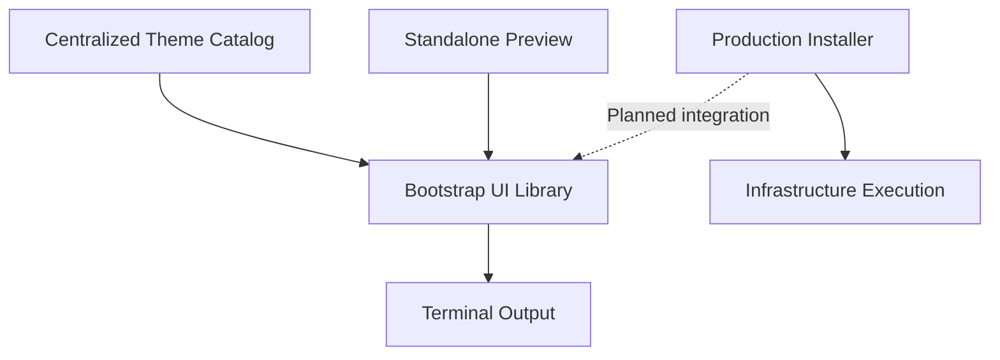
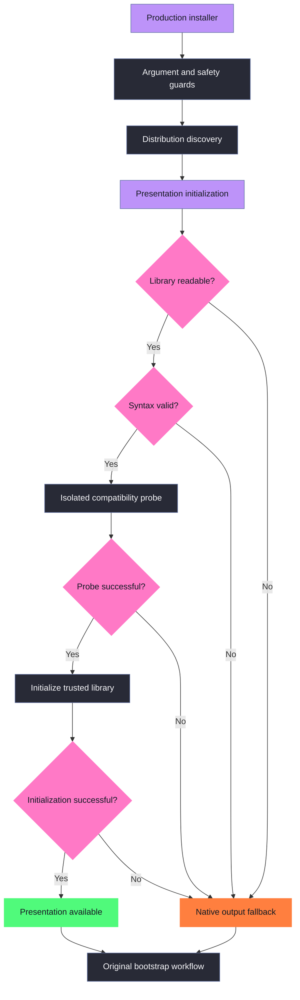
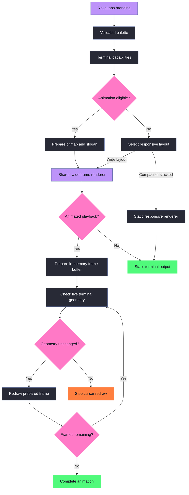
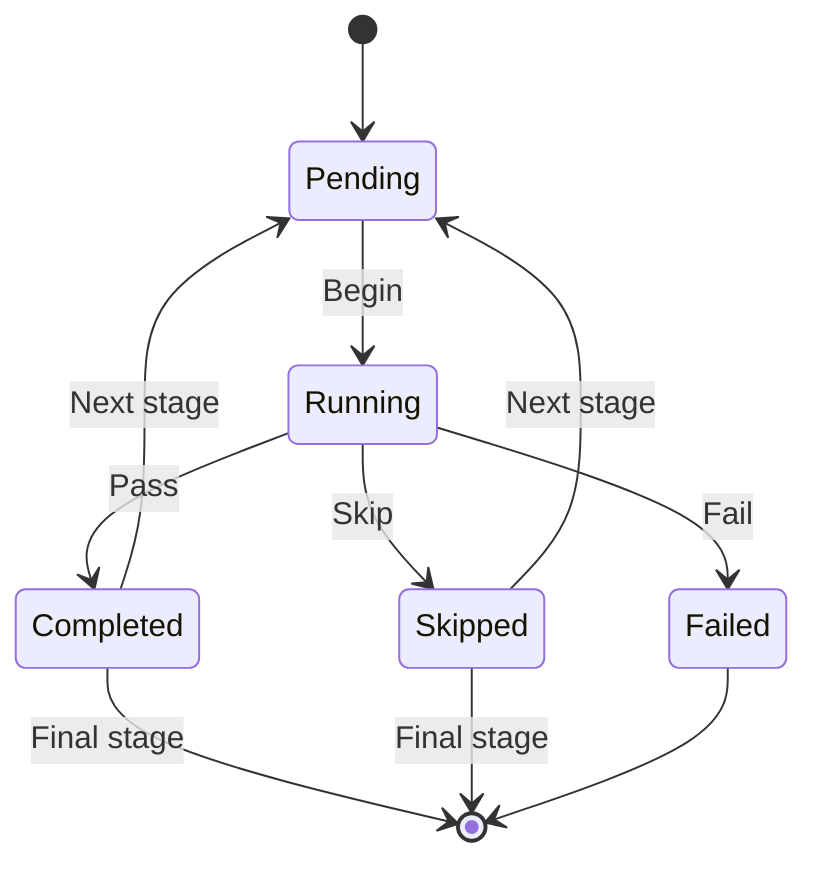

# NovaLabs Bootstrap UI

## Overview

The NovaLabs Bootstrap UI provides a consistent terminal presentation layer for the NovaLabs declarative infrastructure bootstrap workflow.

Its objectives are:

- Establish a recognizable NovaLabs visual identity.
- Present meaningful system and host identity information.
- Communicate bootstrap execution progress.
- Distinguish successful, skipped, failed, and incomplete operations.
- Preserve compatibility with interactive terminals and non-interactive automation.
- Maintain separation between presentation and infrastructure mutation.

The presentation engine is implemented using POSIX shell and standard system utilities rather than an external TUI framework.

## Implementation status

The presentation engine and standalone simulation are implemented and validated.

Integration with the production `install.sh` workflow remains pending.

The standalone preview does not enroll hosts, install applications, reconcile configuration, or modify native packages.

## Architecture

| Component | Responsibility |
|---|---|
| `.chezmoidata/theme.toml` | Authoritative branding and theme catalog |
| `scripts/lib/bootstrap-ui.sh` | Reusable presentation functions |
| `scripts/preview-bootstrap-ui.sh` | Standalone presentation simulation |
| `scripts/test-bootstrap-ui.sh` | Automated presentation regression tests |
| `install.sh` | Authoritative bootstrap execution workflow |
| `scripts/test-bootstrap-ui-pty.py` | Automated interactive terminal compatibility and animation regression tests |
| `scripts/test-bootstrap-adapter.sh` | Presentation adapter initialization, fallback and state preservation regression tests |
| `scripts/test-bootstrap-integration.sh` | Production installer preview and safety guard integration tests |

The presentation library is sourced by its caller. It does not independently initiate bootstrap execution, change global shell options, or install signal handlers.

### Separation of responsibilities



The production installer remains responsible for:

- Runtime installation and verification.
- ChezMoi enrollment.
- Host policy validation.
- Native package reconciliation.
- Configuration reconciliation.
- Application installation.
- Profile-specific operations.
- Application version auditing and pruning.
- Exit-status handling.

The presentation library reports execution state supplied by the caller. It must not independently determine whether an infrastructure operation succeeded.

## Visual identity

### Brand palette

NovaLabs bootstrap branding uses a fixed six-color gradient.

The palette is declared in `[theme.bootstrap.brand]` within `.chezmoidata/theme.toml`.

| Stop | Color |
|---|---|
| `stop_1` | `#FBDD49` |
| `stop_2` | `#FE8103` |
| `stop_3` | `#FF1C6B` |
| `stop_4` | `#E200A2` |
| `stop_5` | `#9B04DB` |
| `stop_6` | `#6C1DC6` |

The brand gradient is applied to the NOVALABS logo and the declared slogan:

```text
DECLARATIVE INFRASTRUCTURE
```

The wide logo consists of five rows and 63 columns.

The brand palette remains independent of the selected host profile.

### Semantic colors

Existing theme catalog values define the semantic presentation roles.

| Role | Catalog reference | Color |
|---|---|---|
| Section headings | `theme.hosts.any.shade_1` | `#BD93F9` |
| Highlighted values | `theme.hosts.any.shade_4` | `#FF79C6` |
| Success | `theme.shared.success` | `#50FA7B` |
| Failure | `theme.shared.error` | `#FF5555` |
| Warning | `theme.shared.warning` | `#FF7F3F` |
| Foreground | `theme.shared.text_light` | `#F7F7FB` |
| Secondary information | `theme.tui.muted` | `#A0A4B8` |

Host-specific palettes supplement these roles rather than replace them.

### Status indicators

| State | Interactive | Plain output |
|---|---|---|
| Success | ✓ | `[OK]` |
| Failure | ✗ | `[FAIL]` |
| Warning | ! | `[WARN]` |
| Running | → | `[RUN]` |
| Skipped | – | `[SKIP]` |
| Information | • | `[INFO]` |

Plain-text indicators are intended to remain readable in redirected output, CI logs, and terminals without color support.

## Production presentation adapter

The production installer initializes the optional presentation
engine through a dedicated adapter.

Infrastructure execution remains the responsibility of `install.sh`.
The presentation engine reports execution state without becoming
the authority for installation operations or their results.

### Initialization sequence

Presentation initialization occurs after:

1. Argument parsing.
2. Prune safety validation.
3. Normal-user privilege validation.
4. Supported kernel validation.
5. Linux distribution discovery.

Help, invalid arguments, privilege rejection, unsupported kernels
and the FreeBSD stage-only workflow retain their existing early-exit
behavior.

The adapter performs the following checks before enabling presentation:

- Presentation library existence and readability.
- POSIX shell syntax validation.
- Isolated library loading and initialization probe.
- Required presentation function inventory validation.
- Initialization in the calling installer shell.

An unsuccessful compatibility probe leaves enhanced presentation
unavailable.

Missing or malformed theme catalog data selects the presentation
library's plain rendering mode instead.

### Adapter architecture



### Presentation availability

The adapter distinguishes between presentation availability and
rendering capability.

| State | Behavior |
|---|---|
| Available, colored | Enhanced color presentation is supported |
| Available, plain | Presentation functions remain usable without ANSI colors |
| Unavailable | Original installer output remains the fallback |
| Disabled after failure | Subsequent guarded presentation calls are suppressed |

The `bootstrap_ui_init` function establishes presentation availability.

The `bootstrap_ui_call` function invokes presentation functions
while containing explicitly returned nonzero statuses.

A failed guarded presentation call disables subsequent presentation
calls and attempts to reset terminal text attributes.

Presentation calls execute in the current shell to preserve
stateful execution tracking.

Infrastructure commands must never be passed to the presentation
adapter.

### Isolation boundaries

The compatibility probe is not a security sandbox.

The presentation library is trusted repository-owned shell code.
Sourcing that code in the installer process cannot provide complete
isolation from arbitrary shell termination, global state changes,
or other shell-level failures.

Guarded function invocation also affects shell errexit semantics.
Presentation functions must explicitly propagate failures where
those failures need to be detected by the adapter.

The adapter currently contains ordinary initialization and
explicitly returned rendering failures.

Preservation of real infrastructure exit statuses and signal
interruption behavior requires additional lifecycle integration
and regression testing.

### Production presentation CLI

Presentation preferences are parsed before adapter initialization.
Execution and presentation configuration remain independent.

| Argument | Configuration change |
|---|---|
| `--apply` | `mode=apply` |
| `--prune` | `prune=true` |
| `--plain` | `NL_UI_PLAIN=true`, `NL_UI_NO_ANIMATION=true` |
| `--no-animation` | `NL_UI_NO_ANIMATION=true` |

Both presentation variables default to `false`.
Presentation arguments are repeatable and order-independent.
Plain mode explicitly disables animation.

The existing prune safety guard remains authoritative.
Presentation arguments cannot enable infrastructure mutation
or bypass argument validation. They remain accepted when the
optional presentation library is unavailable.

These preferences apply to NovaLabs-generated presentation,
not colors emitted independently by native tools or subprocesses.

The CLI integration checkpoint validated argument parsing and configuration
propagation. Production preview rendering now consumes these settings.

### Production preview orchestration

The Linux preview dispatcher selects `bootstrap_enhanced_preview` when
presentation is available. It uses guarded calls through `bootstrap_ui_call`
to render branding, system and runtime identity, enrollment policy, the
planned eight-stage workflow, native package policies and completion.

Runtime pins and the named-profile package inventory are read from the
installer's existing configuration. Host identity is not inferred from the
hostname: the profile remains unresolved until authoritative enrollment.
The preview does not start the execution tracker or report planned stages
as completed operations.

| Presentation state | Preview behavior |
|---|---|
| Available, animation eligible | Animated branding and enhanced preview |
| Available, animation disabled | Static branding and enhanced preview |
| Available, plain | Enhanced textual preview without presentation ANSI sequences |
| Unavailable | Original native preview |
| Explicit rendering failure | Disable guarded calls and render original native preview |

The original preview heredoc is retained in `bootstrap_native_preview`.
If presentation becomes unavailable partway through rendering, previously
printed content is not erased; some information may be repeated when the
native fallback provides the complete original preview.

Preview exits before runtime downloads, enrollment or infrastructure
execution. Apply-mode commands and package policies are unchanged.
The descriptive plan must remain synchronized with the actual workflow.

### Apply runtime and enrollment instrumentation

Phase 4.06 adds optional apply startup branding, actual system and runtime
identity, and an eight-stage tracker. The first three stages are instrumented
around existing commands, without wrapping those commands in presentation
functions or conditional execution contexts.

| Stage | Success boundary |
|---|---|
| 01 — Bootstrap runtime | Pinned Mise executable and version verification succeed |
| 02 — ChezMoi enrollment | Native `chezmoi init` returns successfully |
| 03 — Host policy validation | Validator, template resolution and existing Docker checks succeed |

Native command output and prompts are retained. Explicit presentation
failures disable subsequent guarded calls without changing infrastructure
execution. Failed commands cannot reach the corresponding success call.
The existing shell exit and temporary-file trap behavior is not changed
in this checkpoint. Failure summaries, signal handling and stages 04–08
remain pending. No final tracker summary
is emitted until all stages and lifecycle handling are integrated.

The original Phase 4.06 `scripts/test-bootstrap-runtime.sh` fixtures copy the
actual installer prefix into a temporary repository, cut execution off
before native package convergence, and use fake Mise, ChezMoi, fetcher
and Docker commands with an isolated HOME. The test cannot validate the
later execution stages or a live installation. It verifies command order,
selected failure statuses, native output, presentation failure containment
and existing validator cleanup. Run it as a normal user on Linux:

```bash
bash scripts/test-bootstrap-runtime.sh
```

All 12 apply-prefix checkpoints passed on AMD64 Ubuntu WSL:

| Checkpoint | Result |
|---|---|
| Existing pinned runtime and tracked apply prefix | Passed |
| Fresh pinned runtime installation fixture | Passed |
| Apply prefix without optional presentation | Passed |
| Startup rendering failure preserves execution | Passed |
| Stage reporting failure preserves execution | Passed |
| Runtime installer failure preserves exit status | Passed |
| Runtime version mismatch stops enrollment | Passed |
| Enrollment failure preserves exit status | Passed |
| Validator rendering failure preserves exit status | Passed |
| Host validator failure preserves exit status | Passed |
| Host profile resolution failure preserves exit status | Passed |
| Docker prerequisite failure retains existing guard | Passed |

These results validate the mocked apply prefix only. Native enrollment
output and diagnostics are retained; real interactive enrollment and live
apply remain unvalidated.

### Authoritative host identity integration

Phase 4.07 renders host identity after Stage 03 passes. The resolved ChezMoi
profile selects a section in the existing theme catalog; no hostname inference,
additional enrollment or infrastructure policy changes are introduced.
Missing display metadata omits the optional identity section. Missing or
invalid palette shades omit both accent and palette while retaining valid
identity metadata. An explicit renderer failure disables guarded presentation
calls without stopping infrastructure execution. Preview remains unresolved.

Eight additional isolated apply-prefix checkpoints cover authoritative profile
selection, all nine catalog identities (including mocked OPNsense metadata,
not real OPNsense apply), generic enrollment, missing catalog, missing host
metadata, malformed palette, renderer failure and validation ordering.
All eight additional checkpoints passed on AMD64 Ubuntu WSL:

| Checkpoint | Result |
|---|---|
| Authoritative profile selection | Passed |
| All nine catalog identities in mocked apply prefix | Passed |
| Generic enrollment remains authoritative | Passed |
| Missing presentation catalog preserves execution | Passed |
| Missing host metadata preserves execution | Passed |
| Malformed host palette omitted | Passed |
| Host identity rendering failure preserves execution | Passed |
| Host validation precedes identity rendering | Passed |

The combined apply-prefix suite now contains 20 passing checkpoints.
These results do not establish live enrollment or live apply acceptance.

### Native prerequisites and configuration integration

Phase 4.08 instruments stages 04 and 05 around existing native commands.
Generic Debian-family hosts report minimal toolchain convergence; named
Debian-family hosts report full baseline convergence. Generic non-Debian
hosts report only C compiler verification and externally managed native
prerequisites; libatomic availability is not verified. Existing guards,
package arguments, native output and ChezMoi apply semantics are retained.

The original 20 apply-prefix checkpoints retain their Stage 04 cutoff.
Nine extended checkpoints use a separate Stage 06 cutoff, a fixture-only
Linux distribution override, isolated HOME, mocked sudo/APT and ChezMoi
apply, and a fixture compiler executable. No live package or configuration
changes occur. The sudo shim never executes a real command. Coverage includes
minimal and full package arguments, external policy, unsupported named
platform, APT update/install failures, apply failure and optional UI failure.
All nine additional checkpoints passed on AMD64 Ubuntu WSL:

| Checkpoint | Result |
|---|---|
| Generic Debian-family minimal prerequisites and configuration | Passed |
| Named Debian-family full native baseline | Passed |
| Generic externally managed prerequisites | Passed |
| Named unsupported distribution guard | Passed |
| APT update failure preserves exit status | Passed |
| APT install failure preserves exit status | Passed |
| ChezMoi apply failure preserves exit status | Passed |
| Native and configuration execution without presentation | Passed |
| Stage 04 presentation failure preserves native execution | Passed |

The combined apply-prefix suite contains 29 passing checkpoints. These
results establish isolated acceptance through Stage 05, not live apply acceptance.

### Application convergence and Chronytop integration

Phase 4.09 instruments stages 06 and 07 without changing the existing
Mise convergence or Chronytop installation commands. Managed Chronytop
success is reported only after the final executable version check;
current and replaced binaries have distinct success messages. The skip
policy is recorded as an intentional skipped stage. Existing failure
statuses, including explicit policy guards returning 1, are retained.

A third apply-prefix fixture scope stops before Stage 08. It redirects
managed paths into a temporary repository, uses synthetic release files,
real SHA-256 checks, simulated ownership and measured file permissions,
and constrained sudo and download shims. It never invokes real sudo or
retrieves a live release. Existing 29 checkpoints retain their cutoffs.
Seventeen additional checkpoints cover convergence, skipped policy,
managed current/replaced binaries, invalid mode, retrieval and checksum
failures, staged-file cleanup, version failure, policy guards and optional
presentation failure. All 17 additional checkpoints passed on AMD64 Ubuntu WSL:

| Checkpoint | Result |
|---|---|
| Application convergence and skipped Chronytop | Passed |
| Mise convergence failure preserves exit status | Passed |
| Current Chronytop checksum and metadata verification | Passed |
| Chronytop download checksum and atomic replacement | Passed |
| Chronytop incorrect mode triggers replacement | Passed |
| Chronytop checksum retrieval failure | Passed |
| Chronytop malformed release checksum rejection | Passed |
| Chronytop download failure cleanup | Passed |
| Chronytop corrupt download rejected by real checksum | Passed |
| Chronytop staging failure cleanup | Passed |
| Chronytop replacement failure cleanup | Passed |
| Chronytop final version failure preserves exit status | Passed |
| Chronytop managed policy rejects non-Proxmox profile | Passed |
| Chronytop requires existing Chrony executable | Passed |
| Unsupported Chronytop policy retains guard | Passed |
| Managed Chronytop without presentation | Passed |
| Chronytop presentation failure preserves execution | Passed |

The combined apply-prefix suite contains 46 passing checkpoints. These
results establish isolated acceptance through Stage 07, not live apply acceptance.

### Application audit and optional pruning integration

Phase 4.10 instruments Stage 08 around existing Mise audit and prune
commands. Audit always runs during apply; prune runs only with explicit
`--prune`. A successful audit without pruning counts as a completed stage.
Audit or prune failure prevents stage success and retains its exit status.
The native completion message remains; final lifecycle summaries are pending.

A fourth fixture scope executes the complete installer to its natural exit,
with existing managed-path redirection and constrained infrastructure shims.
Eight additional checkpoints cover audit-only and explicit pruning paths,
audit and prune failures, missing presentation, Stage 08 rendering failure,
managed Chronytop through audit and earlier failure short-circuiting.
All eight additional checkpoints passed on AMD64 Ubuntu WSL:

| Checkpoint | Result |
|---|---|
| Full apply audits without implicit pruning | Passed |
| Explicit pruning follows successful audit | Passed |
| Audit failure prevents pruning and preserves status | Passed |
| Prune failure preserves exit status | Passed |
| Full apply with pruning without presentation | Passed |
| Stage 08 rendering failure preserves audit and pruning | Passed |
| Full managed Chronytop apply reaches audit | Passed |
| Earlier failure prevents audit and pruning | Passed |

The combined apply integration suite contains 54 passing checkpoints.
These results establish full-length isolated apply acceptance, not live
apply acceptance.

### Execution lifecycle integration

Phase 4.11 registers apply-only exit and HUP/INT/TERM handlers before Stage 01.
The exit handler captures the original status before best-effort cleanup,
attributes failures to an active tracked stage, emits one final summary and
restores presentation attributes. If rendering is unavailable or explicitly
fails, native diagnostics preserve the execution outcome. Successful early
fixture exits remain incomplete, not successful eight-stage executions.

Signal handlers explicitly exit with statuses 129, 130 and 143. POSIX shells
may defer traps while a foreground child executes; no child termination or
rollback guarantee is introduced. Cleanup removes validator and download
files and attempts privileged removal of a remaining staged Chronytop file.
Cleanup errors are reported without changing the original status. SIGKILL,
power loss, and inaccessible artifacts cannot be guaranteed recoverable.
The installed binary is not rolled back on a failed version check.

Thirteen additional isolated checkpoints exercise generic and managed
summary counts, active-stage and early failures, incomplete execution,
summary failure fallback, missing presentation, actual HUP/INT/TERM delivery,
interrupted staging and privileged cleanup failure. All thirteen additional
checkpoints passed on AMD64 Ubuntu WSL:

| Checkpoint | Result |
|---|---|
| Generic successful lifecycle accounting | Passed |
| Managed successful lifecycle accounting | Passed |
| Active stage failure accounting | Passed |
| Early enrollment failure summary | Passed |
| Intentional prefix exit remains incomplete | Passed |
| Summary rendering failure preserves success fallback | Passed |
| Summary rendering failure preserves failure fallback | Passed |
| Missing presentation preserves native failure diagnostics | Passed |
| Actual HUP interruption preserves status and stops pruning | Passed |
| Actual INT interruption preserves status and stops pruning | Passed |
| Actual TERM interruption preserves status and stops pruning | Passed |
| Interrupted staging removes partial artifact | Passed |
| Privileged cleanup failure preserves original status | Passed |

The combined apply integration suite contains 67 passing checkpoints.
Signal delivery is exercised in isolated fixtures; live apply acceptance
remains pending.

### Integration hardening

Phase 4.12 makes privileged finalization non-interactive (`sudo -n`),
propagates explicit summary component failures, and extends full apply
fixtures to a controlling pseudo-terminal. The existing staged cleanup
checks now require the non-interactive invocation. Four additional checks
cover partial summary failure on success and failure, colored full apply,
and terminal-generated Ctrl-C during audit. All four additional checkpoints
passed on AMD64 Ubuntu WSL:

| Checkpoint | Result |
|---|---|
| Partial summary failure preserves status 0 and native fallback | Passed |
| Partial summary failure preserves status 71 and native fallback | Passed |
| Controlling terminal apply: success and final ANSI reset | Passed |
| Controlling terminal apply: interrupt and final ANSI reset | Passed |

The combined apply integration suite contains 71 passing checkpoints.
The partial summary can already be visible before native fallback is emitted.

### Integration checkpoint

Phase 4.05 validates enhanced production preview rendering and native
fallback. Phase 4.03 and 4.04 previously validated initialization and CLI
propagation respectively. Phase 4.06 instruments apply startup and stages
01–03; isolated regression acceptance is complete. Phase 4.07 adds
optional authoritative host identity; isolated regression acceptance is complete.
Phase 4.08 instruments stages 04–05; extended regression acceptance is complete.
Phase 4.09 instruments stages 06–07; regression acceptance is complete.
Phase 4.10 instruments Stage 08; full apply fixture acceptance is complete.
Phase 4.11 integrates unified exit handling; regression acceptance is complete.
Phase 4.12 hardens cleanup and summary propagation; controlling-terminal
apply regression acceptance is complete.
No new mandatory runtime dependencies are introduced.

## Terminal compatibility

The presentation engine supports four rendering modes.

| Mode | Behavior |
|---|---|
| `truecolor` | 24-bit RGB colors |
| `256` | ANSI 256-color approximation |
| `ansi` | Basic ANSI color fallback |
| `plain` | No presentation-generated ANSI sequences |

Terminal capabilities are detected using:

- Standard output and standard error TTY availability.
- `TERM`.
- `COLORTERM`.
- `NO_COLOR`.
- `CI`.
- Live terminal geometry through `stty`.
- UTF-8 locale compatibility through `locale charmap`.
- Explicit presentation overrides.

Plain presentation is selected when either output stream is
non-interactive, `TERM=dumb`, `NO_COLOR` is non-empty,
`CI` is non-empty, or plain mode is explicitly requested.

Unrecognized terminal types fall back to plain presentation unless
truecolor support is explicitly advertised.

Missing or invalid bootstrap palette data disables colored rendering
and animation.

### Deterministic palette initialization

Presentation initialization resets all palette variables before loading
the authoritative theme catalog.

If loading or validation fails:

1. All partially loaded palette values are discarded.
2. The safe default branding slogan is restored.
3. Plain presentation is selected.
4. Animation is disabled.

A subsequent initialization can reload valid catalog data without
retaining state from the failed initialization.

The fallback does not introduce a second hardcoded color palette.

### Live terminal geometry

Terminal geometry is obtained through `stty size`, using the terminal
associated with standard error.

The renderer validates both terminal columns and rows before using
them in presentation calculations.

If live terminal geometry cannot be obtained, the presentation
engine uses a default width of 80 columns and disables animation.

The implementation does not depend on potentially stale `COLUMNS`
or `LINES` environment variables for animation eligibility.

### Responsive presentation

| Terminal columns | Logo layout |
|---|---|
| 68 or greater | Full-width NOVALABS logo, provided the spaced slogan fits |
| 36–67 | Stacked NOVA and LABS logo |
| Below 36 | Compact text logo |

The slogan is wrapped to fit the configured terminal width when
the wide layout is unsuitable.

Plain mode uses textual branding.

Non-UTF-8 locales also use textual branding rather than Unicode
block-letter rendering.

Extremely narrow terminals may still wrap the brand name or
other presentation fields.

### Animation eligibility

Animation requires:

- Interactive standard output and standard error.
- A successfully validated bootstrap palette.
- Truecolor or ANSI 256-color rendering.
- Known live terminal geometry.
- At least 68 terminal columns.
- At least 10 terminal rows.
- UTF-8 locale compatibility.
- A spaced slogan that fits the available terminal width.
- Fractional sleep support.
- No explicit animation opt-out.

When these requirements are not satisfied, the renderer selects
an appropriate static presentation.

### Shared rendering architecture

Static and animated wide branding use the same frame renderer.

The wide brand frame consists of five bitmap rows, one blank
separator row, and one slogan row.



### Animation playback

The startup animation applies a moving illumination sweep across
the centralized NovaLabs brand gradient.

Animation frames are prepared in memory before playback begins.

The playback sequence consists of:

1. An initial static brand frame.
2. Twenty-one illumination frames.
3. A final frame restoring the original brand gradient.

The interval between animation frames is approximately 65
milliseconds, producing approximately 1.4 seconds of playback,
excluding frame preparation and terminal output overhead.

Before playback begins, terminal geometry is checked again.

During playback, live terminal geometry is checked before each
cursor redraw. If a geometry change is detected, further cursor
redraw operations are stopped.

The implementation does not:

- Clear the entire terminal screen.
- Hide the terminal cursor.
- Modify terminal modes.
- Start background animation processes.
- Create temporary animation files.
- Introduce an external animation runtime.

Animation can be explicitly disabled without disabling color.

### Rendering limitations

Geometry discovery and terminal output are separate operations.
A resize can occur between a geometry check and a frame redraw.

The renderer cannot guarantee atomic resize handling using
portable shell utilities alone.

Non-UTF-8 fallback currently applies to branding. Other Unicode
presentation elements require additional compatibility review.

Signal interruption behavior remains subject to additional
integration testing.

## System identity

The presentation engine discovers local system identity without requiring ChezMoi enrollment.

Displayed information includes:

| Field | Source |
|---|---|
| Hostname | `uname -n` |
| Distribution | Caller-supplied operating system identification |
| Kernel | `uname -s` |
| Architecture | `uname -m`, normalized for display |
| Release | Local Git revision, when available |
| Mode | Caller-supplied execution mode |

Common architecture identifiers are normalized:

- `x86_64` and `amd64` become `AMD64`.
- `aarch64` and `arm64` become `ARM64`.
- Other identifiers are preserved.

Missing Git revision information is displayed as `unknown`.

The displayed Git revision identifies the checked-out commit. It does not certify working-tree cleanliness.

### Runtime targets

The runtime identity section displays the requested Mise and ChezMoi versions.

These values represent target versions, not evidence of successful runtime installation or verification.

The production installer remains authoritative for runtime version pins. The current standalone preview uses matching demonstration values.

## Host identity

Host identity and visual configuration are maintained in the centralized theme catalog.

Supported profile identifiers are:

| Profile | Identity |
|---|---|
| `any` | Generic Linux |
| `proxmox` | Proxmox |
| `docker` | Docker LXC |
| `pihole` | Pi-hole |
| `ubuntulab` | UbuntuLab |
| `lovelace` | Lovelace |
| `worker1` | Kubernetes worker |
| `zgx` | ZGX |
| `opnsense` | OPNsense |

The host presentation accepts:

- Profile identifier.
- Display name.
- Theme family.
- Four palette shades.

The fourth palette shade is displayed as the host accent.

The four shades are rendered as colored blocks in interactive terminals or hexadecimal values in plain output.

Invalid palette data is omitted rather than rendered.

### Enrollment authority

The presentation library does not infer enrollment from the machine hostname.

During production integration, host profile information must originate from the authoritative ChezMoi enrollment and validated host policy.

The standalone preview uses an explicitly selected demonstration profile. Selecting a preview profile does not change the local machine's actual enrollment.

### Catalog parsing

The early presentation engine reads the required scalar theme values using a restricted shell-compatible catalog reader.

This reader is not a general-purpose TOML parser. The relevant catalog entries must retain their supported section and quoted scalar structure.

Production host profile resolution should use the authoritative ChezMoi template engine after enrollment.

## Execution stage tracking

The presentation library provides explicit stage lifecycle functions.

| Function | Responsibility |
|---|---|
| `nl_ui_tracker_init` | Initialize planned execution stages |
| `nl_ui_stage_begin` | Start the next stage |
| `nl_ui_stage_pass` | Record successful completion |
| `nl_ui_stage_skip` | Record intentional omission |
| `nl_ui_stage_fail` | Record a failed stage and report its exit status |
| `nl_ui_summary` | Present aggregate execution results |

### Stage lifecycle



The tracker rejects overlapping stages, duplicate completion, invalid stage totals, and execution beyond the planned stage count.

Once a stage is recorded as failed, another stage cannot begin until the tracker is reinitialized.

### Execution accounting

The final summary includes:

- Processed and planned stages.
- Completed stages.
- Skipped stages.
- Failed stages.
- Elapsed execution time.
- Caller-supplied exit status.

Processed stages are calculated as:

```text
processed = completed + skipped + failed
```

An active stage is not counted as processed until its outcome is recorded.

A successful completion summary requires all planned stages to have been processed, no failed stages, no active stage, and a zero exit status.

### Summary states

| State | Condition |
|---|---|
| `BOOTSTRAP COMPLETE` | All planned stages processed successfully or intentionally skipped |
| `BOOTSTRAP FAILED` | Nonzero exit status or a recorded failed stage |
| `BOOTSTRAP INCOMPLETE` | Zero exit status but unfinished execution stages |

A presentation summary does not itself determine the process exit status.

The production caller must preserve the actual execution status independently of presentation output.

### Timing

Stage durations and aggregate elapsed time use whole-second wall-clock timestamps.

Negative elapsed durations caused by backward clock changes are reported as zero.

Subsecond operations may report `0s`. Significant system clock adjustments can affect measured durations.

## Standalone preview

The standalone preview provides a complete demonstration of the presentation engine without modifying infrastructure.

### Usage

```bash
sh scripts/preview-bootstrap-ui.sh
```

### Supported arguments

| Argument | Behavior |
|---|---|
| `--profile NAME` | Select a demonstration host profile |
| `--simulate-failure` | Demonstrate a failed execution stage |
| `--no-animation` | Disable animation and presentation delays |
| `--plain` | Disable colored presentation and animation |
| `-h`, `--help` | Display usage information |

The default demonstration profile is `any`.

### Examples

Preview the Lovelace identity:

```bash
sh scripts/preview-bootstrap-ui.sh --profile lovelace
```

Preview Proxmox without animation:

```bash
sh scripts/preview-bootstrap-ui.sh --profile proxmox --no-animation
```

Demonstrate a ZGX configuration failure:

```bash
sh scripts/preview-bootstrap-ui.sh --profile zgx --simulate-failure
```

Generate ANSI-free output:

```bash
sh scripts/preview-bootstrap-ui.sh --profile lovelace --plain
```

Preview the OPNsense exclusion policy:

```bash
sh scripts/preview-bootstrap-ui.sh --profile opnsense
```

### Simulated execution stages

The current preview implements eight demonstration stages.

| Stage | Name |
|---:|---|
| 01 | Bootstrap runtime |
| 02 | Configuration enrollment |
| 03 | Host validation |
| 04 | Native prerequisites |
| 05 | Configuration |
| 06 | Applications |
| 07 | Chronytop |
| 08 | Application audit |

The production stage boundaries remain subject to installer integration.

### Expected scenarios

| Scenario | Processed | Completed | Skipped | Failed | Reported status |
|---|---:|---:|---:|---:|---:|
| Standard Linux | 8/8 | 7 | 1 | 0 | 0 |
| Proxmox | 8/8 | 8 | 0 | 0 | 0 |
| Simulated configuration failure | 5/8 | 4 | 0 | 1 | 42 |
| OPNsense | Not applicable | — | — | — | 0 |

OPNsense does not enter the generic simulated execution stages.

The simulated failure reports exit status `42`, but the preview process exits successfully because the demonstration itself completed and no infrastructure operation failed.

## Regression testing

Run the presentation regression suite from the repository root:

```bash
bash scripts/test-bootstrap-ui.sh
```

Validate POSIX shell syntax independently:

```bash
sh -n scripts/lib/bootstrap-ui.sh
sh -n scripts/preview-bootstrap-ui.sh
```

### Regression coverage

The bootstrap presentation implementation is validated by five
complementary regression suites.

| Suite | Checkpoints | Result |
|---|---:|---|
| Shell presentation regression | 36 | Passed |
| Pseudo-terminal regression | 17 | Passed |
| Production presentation adapter | 11 | Passed |
| Production installer integration | 24 | Passed |
| Apply integration | 71 | Passed |
| **Total** | **159** | **Passed** |

Presentation regression tests validate branding, rendering,
palette initialization, system identity, host palettes, stage
tracking and simulated execution summaries.

Pseudo-terminal tests validate interactive terminal behavior for both the
standalone renderer and the production installer.

Adapter tests validate initialization, fallback, guarded
presentation calls and state preservation.

Installer integration tests validate the actual production entry
point in isolated, non-mutating preview scenarios.

Apply integration tests validate all eight stages and optional host presentation
using command shims, separate cutoffs before stages 04, 06 and 08,
and full-length fixtures reaching the natural process exit. Lifecycle fixtures
exercise summary accounting, signal delivery and best-effort cleanup.
The apply suite also invokes `scripts/test-bootstrap-apply-pty.py` to
validate colored apply and terminal-generated interruption.

### Pseudo-terminal regression testing

Run the interactive terminal regression suite from the
repository root:

```bash
python3 scripts/test-bootstrap-ui-pty.py
```

The suite uses Python standard-library pseudo-terminal facilities
to exercise terminal behavior under controlled conditions.

Python is a development and testing dependency only. It is not
required by the production presentation engine.

| Checkpoint | Result |
|---|---|
| Live geometry and ANSI 256-color animation | Passed |
| Truecolor animation | Passed |
| Minimum animation geometry | Passed |
| Narrow terminal static fallback | Passed |
| Insufficient terminal height fallback | Passed |
| Explicit animation opt-out | Passed |
| NO_COLOR compatibility | Passed |
| CI plain-text compatibility | Passed |
| Non-UTF-8 branding fallback | Passed |
| Live terminal resize protection | Passed |
| Final animation frame consistency | Passed |
| Production 256-color animation | Passed |
| Production truecolor animation | Passed |
| Production static color | Passed |
| Production plain CLI | Passed |
| Production NO_COLOR | Passed |
| Production CI plain mode | Passed |

The suite verifies emitted terminal control sequences, animation
eligibility, redraw counts, fallback behavior and final visible
frame consistency.

The resize test permits one potentially in-flight redraw while
requiring subsequent animation playback to stop.

Final-frame consistency testing compares visible frame content
and geometry rather than exact ANSI color sequences.

### Palette initialization safety

Five additional shell regression checkpoints verify:

- Deterministic fallback after previous initialization.
- Malformed brand color fallback.
- Malformed slogan fallback.
- Late palette-loading failure isolation.
- Recovery after malformed catalog data.

Malformed catalog tests use isolated temporary fixtures and do
not modify the authoritative theme catalog.

### Presentation adapter regression testing

Run the adapter regression suite from the repository root:

```bash
bash scripts/test-bootstrap-adapter.sh
```

The suite extracts the actual adapter functions from `install.sh`
and exercises them in fresh POSIX shells against temporary
repository fixtures.

| Checkpoint | Result |
|---|---|
| Valid presentation library initialization | Passed |
| Missing presentation library fallback | Passed |
| Invalid library syntax rejection | Passed |
| Required function inventory validation | Passed |
| Initialization failure isolation | Passed |
| Missing palette plain-mode fallback | Passed |
| Malformed palette plain-mode fallback | Passed |
| Rendering failure containment | Passed |
| Disabled presentation call suppression | Passed |
| Non-presentation command rejection | Passed |
| Presentation tracker state preservation | Passed |

### Production installer integration testing

Run the installer integration regression suite:

```bash
bash scripts/test-bootstrap-integration.sh
```

The suite executes the actual production installer from isolated
temporary repository fixtures.

| Checkpoint | Result |
|---|---|
| Production preview baseline | Passed |
| Production preview without presentation library | Passed |
| Production preview with invalid library syntax | Passed |
| Production preview with incomplete library | Passed |
| Production preview after initialization failure | Passed |
| Production preview without theme catalog | Passed |
| Production preview with malformed theme catalog | Passed |
| Help exits before presentation initialization | Passed |
| Invalid argument guard precedes presentation | Passed |
| Prune safety guard precedes presentation | Passed |
| Plain presentation argument | Passed |
| No-animation presentation argument | Passed |
| Presentation argument order independence | Passed |
| Repeated presentation arguments | Passed |
| Presentation CLI help documentation | Passed |
| Plain presentation preserves prune safety | Passed |
| No-animation presentation preserves prune safety | Passed |
| Presentation CLI without optional library | Passed |
| Presentation arguments preserve invalid option rejection | Passed |
| Presentation CLI state propagation | Passed |
| Immediate rendering failure native recovery | Passed |
| Partial rendering failure native recovery | Passed |
| Authoritative runtime and package data | Passed |
| Preview infrastructure command isolation | Passed |

CLI propagation testing instruments an isolated fixture library to
capture the presentation configuration received during initialization.
This verifies actual configuration state rather than argument acceptance
alone. The production library and authoritative theme catalog remain
unchanged during these tests.

The suite distinguishes enhanced plain preview output from an independent
expected native fallback baseline. Missing or malformed catalogs retain
enhanced plain rendering. Explicit rendering failures are injected before
and during rendering to verify native recovery. Filesystem sentinels
strengthen early-guard assertions, and selected infrastructure command
shims detect unexpected execution in preview. These checks do not constitute
a comprehensive filesystem mutation audit.

Expected exit statuses are verified for the preview, help,
invalid argument and prune safety scenarios.

The suite does not invoke infrastructure apply operations.

### Combined regression validation

Run all five regression suites from a normal-user Linux
development environment:

```bash
bash scripts/test-bootstrap-ui.sh
python3 scripts/test-bootstrap-ui-pty.py
bash scripts/test-bootstrap-adapter.sh
bash scripts/test-bootstrap-integration.sh
bash scripts/test-bootstrap-runtime.sh
```

The combined integration hardening checkpoint contains 159 passing
regression checks.

Python remains a development-only dependency.

### Acceptance record

The presentation engine has been interactively validated on an AMD64 Ubuntu WSL environment.

| Validation | Result |
|---|---|
| Shell presentation regression | 36/36 passed |
| Pseudo-terminal regression | 17/17 passed |
| Presentation adapter regression | 11/11 passed |
| Production installer integration | 24/24 passed |
| Apply integration | 71/71 passed |
| **Combined regression coverage** | **159/159 passed** |
| Truecolor animation | Passed |
| ANSI 256-color animation | Passed |
| Static presentation | Passed |
| Plain presentation | Passed |
| Lovelace host palette | Passed |
| ZGX host palette | Passed |
| Proxmox host palette | Passed |
| Standard execution simulation | Passed |
| Profile-specific execution simulation | Passed |
| Failed execution simulation | Passed |

The current acceptance record consists of 36 shell presentation
checkpoints, 17 pseudo-terminal checkpoints, 11 presentation
adapter checkpoints, 24 production installer integration checkpoints
and 71 apply integration checkpoints.

All 159 checkpoints passed on the AMD64 WSL development
environment.

These results establish presentation, initialization, CLI, production
preview and full-length isolated apply acceptance, not live production apply
acceptance.

## Safety boundaries

The presentation engine must preserve the existing NovaLabs bootstrap safety model.

The production integration must:

- Preserve preview-only behavior unless installation is explicitly requested.
- Preserve existing host validation before host-specific mutation.
- Preserve runtime version pins.
- Preserve native package and application policies.
- Preserve FreeBSD and OPNsense exclusion behavior.
- Preserve native command output and interactive prompts.
- Preserve actual command and installer exit statuses.
- Preserve temporary-file cleanup.
- Avoid introducing additional privilege requirements.
- Avoid background execution dependencies.
- Avoid allowing presentation-only failures to prevent otherwise valid bootstrap execution.

Presentation functions must not substitute simulated success messages for actual command verification.

No additional package installation is required for the presentation layer itself.

The regression suite uses Bash as a development and testing dependency.

The `scripts/` and `docs/` directories are excluded from ChezMoi reconciliation.

## Known limitations

The following areas require additional validation or integration work:

- Live acceptance of production apply rendering and authoritative host identity.
- Live command exit-status and presentation isolation validation.
- Signal interruption during arbitrary foreground children and cleanup.
- Non-interactive cleanup can leave an artifact if sudo authorization is unavailable.
- Non-UTF-8 compatibility outside branding.
- Extremely narrow terminal layout acceptance.
- Live AMD64 and ARM64 bootstrap canary validation.

Live terminal resize protection has passed automated pseudo-terminal
testing. However, a race remains possible between checking terminal
geometry and issuing a redraw.

The wide animation frame assumes that its seven rendered lines fit
the detected terminal geometry.

Malformed palette initialization is covered by regression testing.
The restricted catalog reader remains intentionally narrower than
a general-purpose TOML parser.

Elapsed-time measurements are not monotonic.

Standalone simulator timings represent demonstration execution, not actual
infrastructure reconciliation performance. The production preview does
not simulate execution-stage timings.

## Implementation roadmap

| Phase | Status |
|---|---|
| 1 — Installer architecture audit | Complete |
| 2 — Branding and animation engine | Complete |
| 3 — Host-aware presentation | Complete |
| 4 — Production bootstrap integration | In progress |
| 5 — Compatibility and regression testing | Pending |
| 6 — Live canary acceptance | Pending |
| 7 — Fleet rollout and final documentation | Pending |

### Phase 4 implementation milestones

| Milestone | Status |
|---|---|
| 4.01 — Integration branch and installer audit | Complete |
| 4.02 — Presentation safety hardening | Complete |
| 4.03 — Optional presentation initialization and fallback | Validated |
| 4.04 — Presentation CLI arguments | Validated |
| 4.05 — Production preview presentation | Validated |
| 4.06 — Runtime and enrollment stages | Validated (isolated apply prefix) |
| 4.07 — Authoritative host identity resolution | Validated (isolated apply prefix) |
| 4.08 — Native prerequisites and configuration | Validated (isolated apply prefix) |
| 4.09 — Applications and Chronytop | Validated (isolated apply prefix) |
| 4.10 — Application audit and optional pruning | Validated (isolated full apply) |
| 4.11 — Exit-status preservation and cleanup | Validated (isolated lifecycle) |
| 4.12 — Integration regression testing | Validated (isolated integration) |
| 4.13 — Documentation and implementation acceptance | Pending |

Presentation safety hardening was introduced in commit `c3a6dfa`
and merged into `main` at
`38cae7fcbc4f3a7c1c4d773fc88b262babfbf979`.

The optional presentation initialization checkpoint has passed
68 combined regression checks without performing infrastructure
apply operations.

The production presentation CLI checkpoint expands combined
regression coverage to 78 passing checks, including argument
parsing, configuration propagation, argument combinations,
help output and preservation of existing safety guards.

The production preview checkpoint expands coverage to 88 passing checks
on AMD64 Ubuntu WSL. Production animation, static color, plain output,
NO_COLOR, CI compatibility and native recovery are validated. Interactive
preview invocations confirm expected content; no live apply was performed.

The runtime and enrollment checkpoint expands combined regression coverage
to 100 passing checks on AMD64 Ubuntu WSL. Apply startup and stages 01–03
are validated with isolated command fixtures, including selected failure
statuses and explicit presentation failure containment. Stages 04–08 and
full lifecycle handling remain pending.

The authoritative host identity checkpoint expands combined coverage to
108 passing checks on AMD64 Ubuntu WSL. Catalog selection, missing metadata,
invalid palette omission, explicit rendering failure containment and host
validation ordering are verified in isolated apply fixtures. Real enrollment
and live apply acceptance remain pending.

The native prerequisites and configuration checkpoint expands combined
coverage to 117 passing checks on AMD64 Ubuntu WSL. Mocked native package
policies, APT and ChezMoi failures, and presentation isolation are verified.
Stages 06–08, full lifecycle handling and live apply acceptance remain pending.

The application and Chronytop checkpoint expands combined coverage to
134 passing checks on AMD64 Ubuntu WSL. Synthetic release verification,
managed and skipped policies, failure cleanup and presentation isolation
are validated. Root ownership is simulated; Stage 08, signal handling
and live apply acceptance remain pending.

The application audit and pruning checkpoint expands combined coverage to
142 passing checks on AMD64 Ubuntu WSL. Full-length mocked apply, explicit
pruning authorization, failure propagation and presentation isolation are
validated. Final lifecycle summaries, signal handling and live apply
acceptance remain pending.

The execution lifecycle checkpoint expands combined coverage to 155 passing
checks on AMD64 Ubuntu WSL. Actual HUP, INT and TERM delivery to fixture
installers, summary accounting, fallback and staged-artifact cleanup are
validated. Live apply acceptance, broader terminal interruption behavior
and integration review remain pending.

The integration hardening checkpoint expands coverage to 159 passing
checks on AMD64 Ubuntu WSL. Non-interactive privileged cleanup, explicit
summary component failures, and terminal-generated Ctrl-C with final ANSI
reset are validated in fixtures. Live apply and dedicated unprivileged
cleanup failure coverage remain pending.

The branding foundation was introduced in commit `9307275` and merged into `main` at `621e8abc3599630a00edb8a3aaf596f23a85304d`.

## Related documentation

- [Application catalog](application-catalog.md)
- [Fleet rollout and acceptance](fleet-rollout.md)
- [Migration ledger](migration-ledger.md)
- [Repository README](../README.md)
