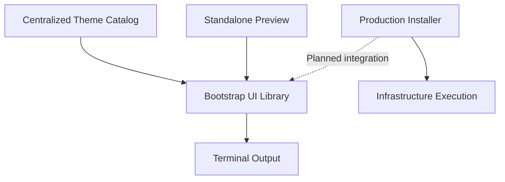
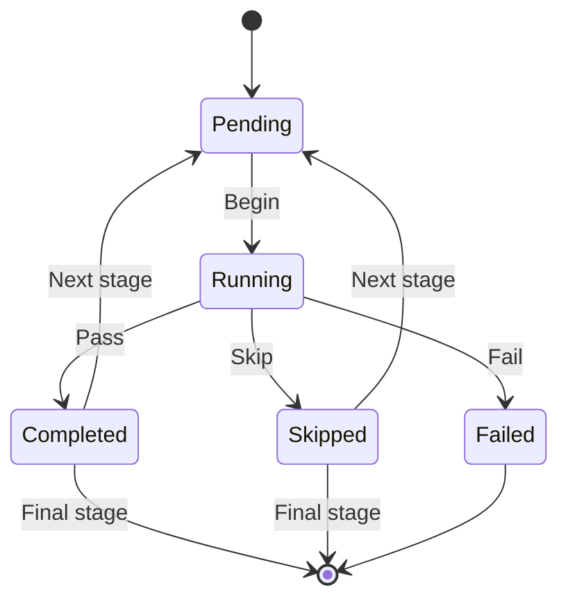

# NovaLabs Bootstrap UI

## Overview

The NovaLabs Bootstrap UI provides a consistent terminal presentation layer for the NovaLabs declarative infrastructure bootstrap workflow.

Its objectives are:

- Establish a recognizable NovaLabs visual identity.
- Present meaningful system and host identity information.
- Communicate bootstrap execution progress.
- Distinguish successful, skipped, failed, and incomplete operations.
- Preserve compatibility with interactive terminals and non-interactive automation.
- Maintain separation between presentation and infrastructure mutation.

The presentation engine is implemented using POSIX shell and standard system utilities rather than an external TUI framework.

## Implementation status

The presentation engine and standalone simulation are implemented and validated.

Integration with the production `install.sh` workflow remains pending.

The standalone preview does not enroll hosts, install applications, reconcile configuration, or modify native packages.

## Architecture

| Component | Responsibility |
|---|---|
| `.chezmoidata/theme.toml` | Authoritative branding and theme catalog |
| `scripts/lib/bootstrap-ui.sh` | Reusable presentation functions |
| `scripts/preview-bootstrap-ui.sh` | Standalone presentation simulation |
| `scripts/test-bootstrap-ui.sh` | Automated presentation regression tests |
| `install.sh` | Authoritative bootstrap execution workflow |

The presentation library is sourced by its caller. It does not independently initiate bootstrap execution, change global shell options, or install signal handlers.

### Separation of responsibilities



The production installer remains responsible for:

- Runtime installation and verification.
- ChezMoi enrollment.
- Host policy validation.
- Native package reconciliation.
- Configuration reconciliation.
- Application installation.
- Profile-specific operations.
- Application version auditing and pruning.
- Exit-status handling.

The presentation library reports execution state supplied by the caller. It must not independently determine whether an infrastructure operation succeeded.

## Visual identity

### Brand palette

NovaLabs bootstrap branding uses a fixed six-color gradient.

The palette is declared in `[theme.bootstrap.brand]` within `.chezmoidata/theme.toml`.

| Stop | Color |
|---|---|
| `stop_1` | `#FBDD49` |
| `stop_2` | `#FE8103` |
| `stop_3` | `#FF1C6B` |
| `stop_4` | `#E200A2` |
| `stop_5` | `#9B04DB` |
| `stop_6` | `#6C1DC6` |

The brand gradient is applied to the NOVALABS logo and the declared slogan:

```text
DECLARATIVE INFRASTRUCTURE
```

The wide logo consists of five rows and 63 columns.

The brand palette remains independent of the selected host profile.

### Semantic colors

Existing theme catalog values define the semantic presentation roles.

| Role | Catalog reference | Color |
|---|---|---|
| Section headings | `theme.hosts.any.shade_1` | `#BD93F9` |
| Highlighted values | `theme.hosts.any.shade_4` | `#FF79C6` |
| Success | `theme.shared.success` | `#50FA7B` |
| Failure | `theme.shared.error` | `#FF5555` |
| Warning | `theme.shared.warning` | `#FF7F3F` |
| Foreground | `theme.shared.text_light` | `#F7F7FB` |
| Secondary information | `theme.tui.muted` | `#A0A4B8` |

Host-specific palettes supplement these roles rather than replace them.

### Status indicators

| State | Interactive | Plain output |
|---|---|---|
| Success | ✓ | `[OK]` |
| Failure | ✗ | `[FAIL]` |
| Warning | ! | `[WARN]` |
| Running | → | `[RUN]` |
| Skipped | – | `[SKIP]` |
| Information | • | `[INFO]` |

Plain-text indicators are intended to remain readable in redirected output, CI logs, and terminals without color support.

## Terminal compatibility

The presentation engine supports four rendering modes.

| Mode | Behavior |
|---|---|
| `truecolor` | 24-bit RGB colors |
| `256` | ANSI 256-color approximation |
| `ansi` | Basic ANSI color fallback |
| `plain` | No presentation-generated ANSI sequences |

Terminal capabilities are detected using:

- Standard output and standard error TTY availability.
- `TERM`.
- `COLORTERM`.
- `NO_COLOR`.
- `CI`.
- Terminal column discovery through `tput`, when available.
- Explicit presentation overrides.

Plain presentation is selected when either output stream is non-interactive, `TERM=dumb`, `NO_COLOR` is non-empty, `CI` is non-empty, or plain mode is explicitly requested.

Missing or invalid bootstrap palette data disables colored rendering and animation.

### Responsive presentation

| Terminal columns | Logo layout |
|---|---|
| 68 or greater | Full-width NOVALABS logo |
| 36–67 | Stacked NOVA and LABS logo |
| Below 36 | Compact text logo |

Plain mode uses a compact textual brand presentation.

Narrow terminal behavior requires additional compatibility acceptance testing.

### Animation

The startup animation applies a moving illumination sweep across the centralized brand gradient.

Animation is restricted to sufficiently wide interactive terminals using truecolor or ANSI 256-color rendering.

The implementation does not:

- Clear the entire terminal screen.
- Hide the terminal cursor.
- Start background animation processes.
- Introduce an external animation runtime.

Animation can be explicitly disabled.

Terminal resizing and signal interruption behavior remain subject to additional regression testing.

## System identity

The presentation engine discovers local system identity without requiring ChezMoi enrollment.

Displayed information includes:

| Field | Source |
|---|---|
| Hostname | `uname -n` |
| Distribution | Caller-supplied operating system identification |
| Kernel | `uname -s` |
| Architecture | `uname -m`, normalized for display |
| Release | Local Git revision, when available |
| Mode | Caller-supplied execution mode |

Common architecture identifiers are normalized:

- `x86_64` and `amd64` become `AMD64`.
- `aarch64` and `arm64` become `ARM64`.
- Other identifiers are preserved.

Missing Git revision information is displayed as `unknown`.

The displayed Git revision identifies the checked-out commit. It does not certify working-tree cleanliness.

### Runtime targets

The runtime identity section displays the requested Mise and ChezMoi versions.

These values represent target versions, not evidence of successful runtime installation or verification.

The production installer remains authoritative for runtime version pins. The current standalone preview uses matching demonstration values.

## Host identity

Host identity and visual configuration are maintained in the centralized theme catalog.

Supported profile identifiers are:

| Profile | Identity |
|---|---|
| `any` | Generic Linux |
| `proxmox` | Proxmox |
| `docker` | Docker LXC |
| `pihole` | Pi-hole |
| `ubuntulab` | UbuntuLab |
| `lovelace` | Lovelace |
| `worker1` | Kubernetes worker |
| `zgx` | ZGX |
| `opnsense` | OPNsense |

The host presentation accepts:

- Profile identifier.
- Display name.
- Theme family.
- Four palette shades.

The fourth palette shade is displayed as the host accent.

The four shades are rendered as colored blocks in interactive terminals or hexadecimal values in plain output.

Invalid palette data is omitted rather than rendered.

### Enrollment authority

The presentation library does not infer enrollment from the machine hostname.

During production integration, host profile information must originate from the authoritative ChezMoi enrollment and validated host policy.

The standalone preview uses an explicitly selected demonstration profile. Selecting a preview profile does not change the local machine's actual enrollment.

### Catalog parsing

The early presentation engine reads the required scalar theme values using a restricted shell-compatible catalog reader.

This reader is not a general-purpose TOML parser. The relevant catalog entries must retain their supported section and quoted scalar structure.

Production host profile resolution should use the authoritative ChezMoi template engine after enrollment.

## Execution stage tracking

The presentation library provides explicit stage lifecycle functions.

| Function | Responsibility |
|---|---|
| `nl_ui_tracker_init` | Initialize planned execution stages |
| `nl_ui_stage_begin` | Start the next stage |
| `nl_ui_stage_pass` | Record successful completion |
| `nl_ui_stage_skip` | Record intentional omission |
| `nl_ui_stage_fail` | Record a failed stage and report its exit status |
| `nl_ui_summary` | Present aggregate execution results |

### Stage lifecycle



The tracker rejects overlapping stages, duplicate completion, invalid stage totals, and execution beyond the planned stage count.

Once a stage is recorded as failed, another stage cannot begin until the tracker is reinitialized.

### Execution accounting

The final summary includes:

- Processed and planned stages.
- Completed stages.
- Skipped stages.
- Failed stages.
- Elapsed execution time.
- Caller-supplied exit status.

Processed stages are calculated as:

```text
processed = completed + skipped + failed
```

An active stage is not counted as processed until its outcome is recorded.

A successful completion summary requires all planned stages to have been processed, no failed stages, no active stage, and a zero exit status.

### Summary states

| State | Condition |
|---|---|
| `BOOTSTRAP COMPLETE` | All planned stages processed successfully or intentionally skipped |
| `BOOTSTRAP FAILED` | Nonzero exit status or a recorded failed stage |
| `BOOTSTRAP INCOMPLETE` | Zero exit status but unfinished execution stages |

A presentation summary does not itself determine the process exit status.

The production caller must preserve the actual execution status independently of presentation output.

### Timing

Stage durations and aggregate elapsed time use whole-second wall-clock timestamps.

Negative elapsed durations caused by backward clock changes are reported as zero.

Subsecond operations may report `0s`. Significant system clock adjustments can affect measured durations.

## Standalone preview

The standalone preview provides a complete demonstration of the presentation engine without modifying infrastructure.

### Usage

```bash
sh scripts/preview-bootstrap-ui.sh
```

### Supported arguments

| Argument | Behavior |
|---|---|
| `--profile NAME` | Select a demonstration host profile |
| `--simulate-failure` | Demonstrate a failed execution stage |
| `--no-animation` | Disable animation and presentation delays |
| `--plain` | Disable colored presentation and animation |
| `-h`, `--help` | Display usage information |

The default demonstration profile is `any`.

### Examples

Preview the Lovelace identity:

```bash
sh scripts/preview-bootstrap-ui.sh --profile lovelace
```

Preview Proxmox without animation:

```bash
sh scripts/preview-bootstrap-ui.sh --profile proxmox --no-animation
```

Demonstrate a ZGX configuration failure:

```bash
sh scripts/preview-bootstrap-ui.sh --profile zgx --simulate-failure
```

Generate ANSI-free output:

```bash
sh scripts/preview-bootstrap-ui.sh --profile lovelace --plain
```

Preview the OPNsense exclusion policy:

```bash
sh scripts/preview-bootstrap-ui.sh --profile opnsense
```

### Simulated execution stages

The current preview implements eight demonstration stages.

| Stage | Name |
|---:|---|
| 01 | Bootstrap runtime |
| 02 | Configuration enrollment |
| 03 | Host validation |
| 04 | Native prerequisites |
| 05 | Configuration |
| 06 | Applications |
| 07 | Chronytop |
| 08 | Application audit |

The production stage boundaries remain subject to installer integration.

### Expected scenarios

| Scenario | Processed | Completed | Skipped | Failed | Reported status |
|---|---:|---:|---:|---:|---:|
| Standard Linux | 8/8 | 7 | 1 | 0 | 0 |
| Proxmox | 8/8 | 8 | 0 | 0 | 0 |
| Simulated configuration failure | 5/8 | 4 | 0 | 1 | 42 |
| OPNsense | Not applicable | — | — | — | 0 |

OPNsense does not enter the generic simulated execution stages.

The simulated failure reports exit status `42`, but the preview process exits successfully because the demonstration itself completed and no infrastructure operation failed.

## Regression testing

Run the presentation regression suite from the repository root:

```bash
bash scripts/test-bootstrap-ui.sh
```

Validate POSIX shell syntax independently:

```bash
sh -n scripts/lib/bootstrap-ui.sh
sh -n scripts/preview-bootstrap-ui.sh
```

### Regression coverage

The current suite contains 31 presentation checkpoints.

| Category | Checkpoints |
|---|---:|
| Branding and terminal rendering | 13 |
| System identity and host palettes | 6 |
| Timing and stage state management | 6 |
| Preview scenarios and CLI validation | 6 |
| **Total** | **31** |

Coverage includes:

- Shell syntax and centralized theme loading.
- RGB validation and terminal color encoding.
- Logo bitmap dimensions.
- Missing palette fallback.
- ANSI-free non-interactive output.
- Help and invalid argument handling.
- Architecture normalization.
- Missing repository revision fallback.
- Semantic status indicators.
- Catalog validation for all nine host profiles.
- Plain and invalid host palette handling.
- Elapsed-time calculations.
- Valid and invalid stage transitions.
- Successful, failed, and incomplete execution summaries.
- Standard, Proxmox, failed, and OPNsense preview scenarios.

### Acceptance record

The presentation engine has been interactively validated on an AMD64 Ubuntu WSL environment.

| Validation | Result |
|---|---|
| Foundational regression suite | 13/13 passed |
| Expanded regression suite | 31/31 passed |
| Truecolor animation | Passed |
| ANSI 256-color animation | Passed |
| Static presentation | Passed |
| Plain presentation | Passed |
| Lovelace host palette | Passed |
| ZGX host palette | Passed |
| Proxmox host palette | Passed |
| Standard execution simulation | Passed |
| Profile-specific execution simulation | Passed |
| Failed execution simulation | Passed |

These results establish presentation-layer acceptance only. They do not establish production bootstrap acceptance.

## Safety boundaries

The presentation engine must preserve the existing NovaLabs bootstrap safety model.

The production integration must:

- Preserve preview-only behavior unless installation is explicitly requested.
- Preserve existing host validation before host-specific mutation.
- Preserve runtime version pins.
- Preserve native package and application policies.
- Preserve FreeBSD and OPNsense exclusion behavior.
- Preserve native command output and interactive prompts.
- Preserve actual command and installer exit statuses.
- Preserve temporary-file cleanup.
- Avoid introducing additional privilege requirements.
- Avoid background execution dependencies.
- Avoid allowing presentation-only failures to prevent otherwise valid bootstrap execution.

Presentation functions must not substitute simulated success messages for actual command verification.

No additional package installation is required for the presentation layer itself.

The regression suite uses Bash as a development and testing dependency.

The `scripts/` and `docs/` directories are excluded from ChezMoi reconciliation.

## Known limitations

The following areas require additional validation or integration work:

- Production installer integration.
- Authoritative ChezMoi host profile resolution.
- Preservation of real command exit statuses.
- Presentation failure isolation.
- Signal interruption and cleanup behavior.
- Terminal resizing during animation.
- Automated pseudo-terminal compatibility testing.
- Narrow terminal layout acceptance.
- Malformed catalog fallback behavior.
- Consolidation of duplicated logo rendering paths.
- Live AMD64 and ARM64 bootstrap canary validation.

The animation renderer currently assumes a fixed seven-line wide-logo frame during redraw. Terminal resizing and wrapping can invalidate that assumption.

Elapsed-time measurements are not monotonic.

Preview timings represent demonstration execution, not actual infrastructure reconciliation performance.

## Implementation roadmap

| Phase | Status |
|---|---|
| 1 — Installer architecture audit | Complete |
| 2 — Branding and animation engine | Complete |
| 3 — Host-aware presentation | Validated |
| 4 — Production bootstrap integration | Pending |
| 5 — Compatibility and regression testing | Pending |
| 6 — Live canary acceptance | Pending |
| 7 — Fleet rollout and final documentation | Pending |

The branding foundation was introduced in commit `9307275` and merged into `main` at `621e8abc3599630a00edb8a3aaf596f23a85304d`.

## Related documentation

- [Application catalog](application-catalog.md)
- [Fleet rollout and acceptance](fleet-rollout.md)
- [Migration ledger](migration-ledger.md)
- [Repository README](../README.md)
